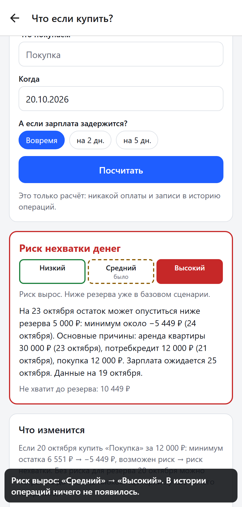

# Финансовый бригадир

**Хватит ли денег до следующего дохода — до покупки, а не после**

Прогноз остатка по дням и риск нехватки на конкретную дату
Конкурс «Финтех без границ» ВТБ · защита 8 декабря 2026

---

## Проблема

- История операций отвечает на вопрос «куда ушли деньги». Решение о покупке человек принимает **до** будущих платежей и **до** зарплаты.
- 35 000 ₽ на счёте, через 6 дней платёж 18 000 ₽, зарплата может задержаться на 2 дня. Можно ли купить что-то за 12 000 ₽ сегодня?
- 60 % опрошенных не имеют сбережений [S1]; 37 % ведут бюджет только в уме [S3]

> Цифры — из открытых опросов; они показывают масштаб уязвимости, а не размер нашего рынка.

---

## Решение

1. **Остаток по каждому будущему дню** — базовый, плохой и хороший сценарий
2. **Риск — дата, когда деньги опускаются ниже вашего резерва**, а не только ниже нуля
3. **«Что если купить?»** — пересчёт до решения и расчётный лимит покупки
4. **Объяснение причин**: какие платежи, траты и задержка дохода создают риск
5. **Редкие предупреждения**: не больше 2 в неделю, повтор того же риска подавляется, тихие часы

Сервис не банк и не проводит платежи.

---

## Демо: покупка 12 000 ₽

| | Сейчас | Купить 20.10 |
|---|---|---|
| Уровень риска | **Средний** | **Высокий** |
| Минимум остатка | ≈6 550 ₽ | ≈−5 450 ₽ |
| Резерв сохранится при покупке | до ≈750 ₽ | — |

Зарплата на 2 дня позже: минимум 6 550 → 3 830 ₽, резерв под угрозой с 26.10.

Риск показываем **ступенью**, а не процентом: на реальных данных модель ещё не откалибрована (ADR-0006).

---

## Как это работает

- **Источники:** CSV-выписка, ручной ввод, синтетика; банковский API — через адаптер `BankConnector`, сейчас мок с явным согласием на 24 часа
- **Нормализация:** переводы между своими счетами, возвраты и погашение кредитки не считаются тратами; вероятные дубли подтверждает пользователь
- **Модель `mc-0.1`:** 1000 вариантов будущего — траты по дню недели, крупные покупки, задержка дохода; при истории короче 28 дней — календарная `baseline-0.1`
- **Предупреждения:** Alert Policy Engine решает «отправить / отложить / подавить» и объясняет почему
- FastAPI · PostgreSQL · Expo (web, Android, iOS) · `forecast_core` без зависимостей от UI и банка

---

## Доказательства, а не обещания

Бэктест на синтетике, 30 профилей каждого типа: модель видит только прошлое, оценка — по скрытому будущему.

| Профиль | Календарь (A) | Медиана (B) | **Симуляция (P)** |
|---|---:|---:|---:|
| Молодой специалист, MAE остатка | 26 774 ₽ | 11 291 ₽ | **8 680 ₽** |
| Фрилансер, MAE | 35 618 ₽ | 25 022 ₽ | **14 916 ₽** |
| Факт в коридоре p10–p90 (молодой специалист) | 3 % | 55 % | **87 %** |
| Разрывы пойманы (молодой специалист) | 0 из 22 | 22 из 22 | **22 из 22** |

Честно о слабых местах: у фрилансера модель P даёт больше ложных тревог (21 против 7 у B), дневная калибровка слабая (skill +0,04). Синтетика проверяет корректность, но **не доказывает** качество на реальных людях.

---

## Пилот и on-prem

Тот же код в режиме `APP_MODE=pilot` разворачивается одной командой `docker compose`:

- вход участника по персональному коду и принятым условиям; демо и учебный банк выключены
- снаружи только TLS-прокси; API и БД во внутренней сети **без выхода в интернет**
- общий limiter, защита от подбора кода, CSP/HSTS
- зашифрованные бэкапы; удаление профиля **повторяется после восстановления** старого бэкапа

CI на каждый push поднимает контур с нуля и проверяет: TLS → вход → прогноз → изоляция → бэкап → удаление → восстановление → профиль не вернулся.

---

## Приватность и безопасность

- Пароли банка не запрашиваются никогда; приложение не инициирует платежи
- Экспорт и удаление всех своих данных в один шаг; токены и коды хранятся только хэшами
- IDOR-тест обходит **каждый** путь API с идентификатором: чужой объект — 404
- Аудит зависимостей в CI: `pip-audit`, `npm audit` со шлюзом на новые high/critical
- Логи без финансовых данных; модель угроз — `docs/threat-model.md`

На площадке банка остаются шифрование дисков, сертификат УЦ, 152-ФЗ и банковская тайна — это не закрывается кодом.

---

## Чем отличаемся — гипотеза

Дзен-мани, CoinKeeper и Rocket Money уже прогнозируют расходы и предупреждают о низком остатке. Мы **не заявляем** новизну прогноза или ИИ.

Проверяемое отличие:
- риск нарушения **выбранного резерва на конкретную дату**
- пересчёт **до** решения и расчётный лимит покупки
- предупреждения с контролируемой ценой ошибки

Проверка: функциональное сравнение с конкурентами + 20–30 проблемных интервью.

---

## Бизнес-модель (допущения)

**B2C freemium:** Free 0 ₽ (один счёт, 30 дней) · Plus 199 ₽/мес — серверная политика уже работает · Family — после MVP

`scripts/business_model.py`: 20 000 MAU × 3 % × 199 ₽ = **MRR 119 400 ₽**; с плановыми расходами команды и инфраструктуры — **−59 346 ₽/мес**. Пример ТЗ с 30 % Family: ARPPU 244 ₽, MRR 146 400 ₽, всё ещё минус.

**B2B2C:** лицензируемый Cashflow & Risk Engine для банка, on-prem, пилот с контрольной группой. Эффект для банка считаем только по данным эксперимента.

> Все цены и конверсии — гипотезы до платёжного теста.

---

## Что сделано за 7 недель

| Этап | Результат |
|---|---|
| 19.10–01.11 | монорепозиторий и CI, генератор 5 профилей с 12 аномалиями, импорт CSV, прогноз по дням, симулятор, сквозное демо с планом Б |
| 02–15.11 | Монте-Карло и калибровка, дубли и replay-тесты, предупреждения с подавлением повторов, мобильная сборка |
| 16–29.11 | приватность и удаление, мок банка с согласиями, Free/Plus, критерии качества, Android APK с E2E на эмуляторе |
| 30.11–08.12 | шкала риска, пилотный/on-prem-контур, аудит зависимостей, видео демо в CI |

267 Python-тестов и 29 клиентских; в CI — 4 задачи, Android E2E и запись видео демо.

---

## План развития

1. **Добровольный пилот** 20–30 человек, 4–6 недель: прогноз против факта, интервью
2. **Калибровка** на реальной истории; проценты — только при положительном дневном skill
3. **Эксперимент с уведомлениями**: календарь / событийные / прогнозные (раздел 15.3)
4. **Платёжный тест** Free/Plus: конверсия, удержание, CAC
5. **Запрос интеграции**: OpenAPI, адаптер, on-prem, модель угроз, результаты пилота

Не делаем до проверки гипотез: Family, LLM, сложное ML. Подробно — `docs/roadmap.md`.

---

## Команда и запрос к ВТБ

**Команда:** три инженера — backend/data, client/product, forecasting/QA/infra; обязательное взаимное ревью.

**Просим:**
- обратную связь по сценарию «хватит ли до зарплаты» в мобильном банке
- возможность согласованного пилота с контрольной группой в контуре банка
- технический контакт по тестовому контуру API (без доступа к реальным данным на конкурсе)

---

## Источники

[S1] Russian Field, 2026 · [S3] НАФИ, 2023 · [S6] Grubb et al., J. of Finance, 2025 · [S7] Дзен-мани · [S8] CoinKeeper · [S9] Rocket Money — полный список в разделе 27 ТЗ.

Код и отчёты: репозиторий проекта, ветка `step4ik`. Бэктест — `docs/backtest/baseline.md`, пилот — `docs/pilot.md`, план — `docs/roadmap.md`.

<!-- Экспорт: npx @marp-team/marp-cli docs/pitch/deck.md --pptx (или --pdf) -->
